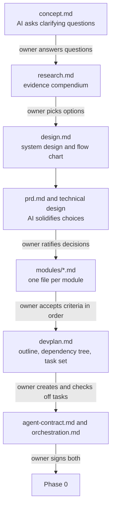

# Planning-phase guidelines

**Status:** draft for Haelyra's sign-off, 2026-11-10 (KAI-016). Generic across projects; Kairos's planning files are the worked examples.

- **What:** one guideline per Planning file. Each holds the file's format, a generator prompt, a self-check, and an owner review checklist.
- **Why:** Focus Queue's development process names the Planning files but not their shape. Without a shared format, each agent invents one, and owner review takes longer.
- **How:** the Project tab (or an agent linked to the step) fills a guideline's placeholders and runs its prompt. The owner then reviews the draft in the document viewer and marks it reviewed.

## Planning flow



## Steps, files, and guidelines

| Step (catalog ID) | File | Written by | Owner gate | Guideline |
|---|---|---|---|---|
| `concept` | `concept.md` | AI after a question round | Answers the questions; marks reviewed | [concept-guideline.md](concept-guideline.md) |
| `research` | `research.md` | Owner and AI together | Supplies sources; picks options; marks reviewed | [research-guideline.md](research-guideline.md) |
| `research` | `design.md` | AI from research | Marks reviewed | [design-guideline.md](design-guideline.md) |
| `prd` | `prd.md` | AI | Marks reviewed | [prd-guideline.md](prd-guideline.md) |
| `prd` | `technical-design.md` | AI solidifies choices | Ratifies each open decision | [technical-design-guideline.md](technical-design-guideline.md) |
| `modules` | `modules/<id>-<slug>.md` | AI, one file per module | Accepts each module's success criteria, in order | [module-guideline.md](module-guideline.md) |
| `devplan` | `devplan.md` | AI outline | Creates tasks from it and checks leaves off | [devplan-guideline.md](devplan-guideline.md) |
| `contract` | `agent-contract.md`, `orchestration.md` | Bundled generator | Reads and signs both | `Config/contract-generator-prompt.md` in the Focus Queue repository (shipped in FOC-117) |

`technical-design.md` joins the `prd` step when a project turns on Planning guidelines. A project's `artifactNames` map can point it at an older file name.

## How a guideline runs

1. **Fill.** The caller fills the placeholders in the guideline's Inputs table. `{{CONVENTIONS}}` is always the block below.
2. **Ask.** Guidelines with a question round return a question form first. The owner answers, and the caller reruns with `{{ANSWERS}}` filled. At most three rounds.
3. **Draft.** The prompt writes the file in the guideline's format and runs its self-check.
4. **Review.** The owner reads the draft against the guideline's review checklist and clicks "Mark reviewed".
5. **Regenerate.** A rerun with `{{EXISTING}}` keeps the owner's wording and flags only lines that break a rule.

## Shared conventions

Every prompt receives this block as `{{CONVENTIONS}}`.

```text
Conventions for every planning file:
- Location. Files live in the project folder under their catalog names. If the project versions planning documents in a repository, the repository copy is the source of truth and the project folder mirrors it byte for byte. Record any name difference in the project's evidence index.
- Header. An H1 title, then a **Status:** line (draft, reviewed, or accepted, with date and task ID), then an **Authority:** line naming which document wins a conflict, then What, Why, and How bullets of one or two sentences each.
- Language. One idea per sentence, at most 25 words, active voice. Lead words carry the information. Lists over prose. Each fact once. Concrete referents: paths, IDs, values. No filler, no self-praise.
- Evidence. Every factual claim cites a source. A number nobody measured says "budget" or "not measured". An owner decision names the owner and the date. Never invent a decision: an open item goes into the file's questions or open-decisions table with an owner.
- IDs. Use stable prefixed IDs: FC (functional criteria), RQ (research questions), E (evidence), M (modules), P (pipelines), C (criteria), D (decisions). Never renumber. Retire an ID with "Withdrawn <date>: <reason>".
- Links. Every shorthand ID links to the file that defines it. Link a sibling planning file by bare name; link anything else by absolute path. The viewer ignores #anchors, so name the section in text (for example "§3").
- Tables. Use <br/> for a line break inside a cell; the renderer drops a table that contains <br>. Escape any literal pipe.
- Diagrams. Mermaid only: flowchart or sequenceDiagram. Quote every label that contains punctuation. Use <br/> for line breaks. No semicolons and no unquoted parentheses in labels. At most 25 nodes per chart.
- Authority. Later files refine earlier ones and never silently contradict them. Owner decisions outrank the technical design, which outranks the PRD, the design, the research, and the concept. A conflict is a defect: propose an amendment and name who decides.
- Size. Each guideline sets a cap. Shorter is better.

Question round format (guidelines with a question round):
- At most 7 questions per round and 3 rounds in total. Ask only what the inputs cannot answer: intent, preferences, constraints, and priorities.
- Each question has one context line, two to four options, one option pre-marked [x] as the recommendation with a short reason, and a "Your answer:" line.
- End with one free-text "Overrides" question. Record every answer, with its date, in the file's questions table.
```

## Sign-off tracker

Haelyra approved the whole set for integration on 2026-11-10 ("Looks good"). In-app sign-off of owner edits is deferred; until it ships, this table is the record.

| Guideline | Signed off | Notes |
|---|---|---|
| [README conventions](#shared-conventions) | [x] | Approved as a set, 2026-11-10 |
| [concept](concept-guideline.md) | [x] | Approved as a set, 2026-11-10 |
| [research](research-guideline.md) | [x] | Approved as a set, 2026-11-10 |
| [design](design-guideline.md) | [x] | Approved as a set, 2026-11-10 |
| [prd](prd-guideline.md) | [x] | Approved as a set, 2026-11-10 |
| [technical design](technical-design-guideline.md) | [x] | Approved as a set, 2026-11-10 |
| [module](module-guideline.md) | [x] | Approved as a set, 2026-11-10 |
| [devplan](devplan-guideline.md) | [x] | Approved as a set, 2026-11-10 |

## Kairos conformance

How Kairos's current Planning files compare with these guidelines. Gaps are fixed only after sign-off.

| File | State | Gap against its guideline |
|---|---|---|
| `concept.md`, `research.md`, `design.md` | Drafted to these guidelines (KAI-016) | None known |
| `prd.md` | Finalized 2026-11-05 | No user-flow chart; workflows carry no FC trace column |
| `technical-design-master-plan.md` | Ratified 2026-11-05 | Name differs from `technical-design.md`; D1-D5 not yet merged (KAI-005) |
| `devplan.md` (mirror of `docs/development-plan-outline.md`) | Draft outline | No leaf checkboxes, no dependency chart, no triage table, no task titles |
| `modules/` | Six KAI-005 drafts on an unmerged branch | No one-line description, no Debug logs section; none registered in `development.json` |
| `agent-contract.md`, `orchestration.md` | Signed 2026-11-10 | None |
