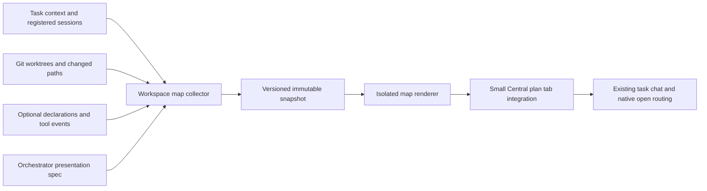

# Workspace map: first design study

Date: 2026-09-13. Status: design proposal for discussion. All agent activity in the interactive study is synthetic.

## Outcome and boundaries

Create a visual orientation layer for Focus Queue: who is working, where, what they consume, what they produce, and what needs the user. Recommend a Map tab beside the central plan, opening to the selected task. The task focus queue remains visible as one entity with an optional orchestrator representation.

The deliverable is a dependency-free HTML study with three interactive map designs, two themes, task selection, scope, search, attention filtering, changes since a simulated visit, zoom, node inspection, and opening-action previews. It does not install a collector, change the running app, launch editors, or monitor actual agents. Approval of a visual direction is a discussion milestone; implementation scope still follows the user's instructions.

Worktree: `/Users/hira/Documents/Github/ECCFocusQueue-agent-map`.
Branch: `feat/agent-workspace-map`.
Base commit: `f5f021b`.

Only `Docs/AgentMap/` is changed. The primary checkout has substantial concurrent edits. Those edits were inspected read-only to understand the future integration surface and were not copied into this branch. Recheck those interfaces after the active agent lands its work.

## Current flow inspected

The working checkout, rather than only the committed base, contains these relevant surfaces as of this study:

| Source in the primary checkout | Observed capability | Proposed integration |
| --- | --- | --- |
| `Sources/ECCFocusQueue/QueueView.swift` | Queue alongside an inspector, with placement-aware layout; task rows open central plans | Keep queue placement, task selection, and existing attention handling |
| `Sources/ECCFocusQueue/PlanCanvasView.swift` | Embedded Markdown, document tabs, editing conflict handling, task conversation in a split view | Add one Map presentation switch; leave document editing and chat ownership in place |
| `Sources/FocusQueueCore/TaskContext.swift` | Canonical context, task/subtask IDs, progress summaries, five-minute heartbeat lifetime, external central plan | Read context through an adapter; do not add map writes to canonical task JSON |
| `Sources/FocusQueueCore/Models.swift` | `TaskAgentSession`: provider, session, task, working directory, optional pane/subtask/context locations | Use provider + session as stable identity; distinguish recorded assignment from actual activity |
| `Sources/FocusQueueCore/TaskWorktreeManager.swift` | Managed worktrees, repository/branch association, retained plan pointers | Read worktree boundaries and context location; never let map cleanup remove worktrees |
| `Sources/FocusQueueSession/main.swift` | Attach, context, plan, add, progress, complete | Later add a separate declaration helper or optional adapter instead of changing current launch semantics |
| `Sources/ECCFocusQueue/QueueViewModel.swift` | Refresh lifecycle and task-context caching | Consume a completed snapshot asynchronously; run filesystem and Git collection off the main actor |

These are integration candidates under concurrent development, not stable interfaces promised by this branch. Existing effectiveStatus maps old working reports to idle; the map should retain the raw report and timestamp to distinguish stale evidence without changing canonical status semantics.

## Design alternatives

### A. Workspace, recommended entry

The physical path expands left to right: queue → workspace root → directory → module → file. A boundary encloses each workspace's physical descendants. Agent badges mark declared scope. Source files and supporting artifacts remain in their actual paths; context outside a worktree is a separate reference rather than falsely nested there.

Default to active and changed paths, collapse quiet directories, and allow progressive expansion. Clicking a node inspects it; opening requires a separate button or double-click. Agent state, owner names, and timestamps stay readable without relying on color. Preserve node positions between updates.

### B. Handoffs

Logical ordering: input context → agent → output → review or dependent agent. This view answers why an agent is waiting. Typed, directed edges distinguish declared dependencies from reported artifacts and observed tool access. Dashed intent must not look like proof that an agent consumed context or finished work.

Show a selected agent's immediate neighborhood by default at fleet scale. Expand supporting relationships deliberately. Backward dependencies are valid and should route through dedicated lanes in the live renderer.

### C. All agents

Task lanes align workspace, agents, and the latest handoff. This is the eventual overview across repositories and agents. Start at summary level, with exceptions emphasized and file details available on selection. Unassigned agents and unavailable locations need explicit buckets. One agent may have multiple work locations and referenced resources; avoid encoding a single parent-only tree as the data model.

### Themes

Paper uses warm gray, muted teal, and thin directory rules for plan review. Graphite uses charcoal, light labels, and restrained state accents alongside terminals. Owner identity uses names plus optional consistent color; red/amber/green are reserved for state. Neither theme needs animation to look alive. Prefer short, user-requested transitions and respect reduced motion.

## Flow and defaults

1. User starts in the existing queue. Current ordering and task alerts persist.
2. Central plan → Map opens the selected task with stable, bounded detail.
3. Needs attention reveals blocked or stale nodes and their ancestors; unrelated nodes dim rather than jump away.
4. Since last visit compares semantic snapshots for that user and scope. New output, changed status, and new assignment matter; heartbeat-only timestamps should not mark everything changed. The study uses a fixed illustrative baseline.
5. Single-click shows concise activity, owners, source of evidence, update age, location, and next dependency.
6. An explicit action opens the relevant session, folder, or artifact. Context can be attached to the task chat before the user sends a message.
7. Switching back to Plan retains map selection and zoom. Keep conversation beside either view using the app's current split layout. The study's compact conversation strip represents that existing conversation, rather than proposing a second chat implementation.

On narrow panels keep the queue available, use horizontal map scrolling, and place detail under the graph or in the existing inspector. Do not shrink labels indefinitely to force an entire fleet into a small panel. The prototype bounds Fit to 65% for readability, so very narrow views retain scrolling.

## Modular architecture



Proposed modules, all future work:

- `Scripts/workspace_map/`: read-only collection, normalization, event validation, atomic snapshots. Reuse Python already used by project scripts if it simplifies integration; avoid adding a daemon before measurements justify it.
- `Sources/FocusQueueMap/`: independent snapshot models, reconciliation, and deterministic layout. A separate SwiftPM target is an option after the package changes settle.
- An isolated map view in SwiftUI using Canvas for connectors plus accessible node controls. The HTML study can alternatively be bundled into WKWebView behind a small typed bridge, if measured iteration speed warrants it. Compare a 100-node fixture in both before committing to a renderer.
- A small adapter in the central plan receives task scope and snapshot URL and returns selected node IDs to existing routing. Delay edits to the actively changing view/model files until their interfaces settle.

The renderer consumes a versioned snapshot. It never runs Git itself and never writes task status. A collector error retains the last good snapshot, its original timestamp, and a visible source-error state. A disabled or missing collector yields a useful empty state with the last known task and workspace.

## Script-maintained facts and agent-designed presentation

The orchestrator may author a versioned `presentation.json`: preferred lens, groups, collapsed roots, pinned artifacts, human-readable labels, and role colors. It references stable node IDs or scoped path prefixes. The collector owns facts, timestamps, claims, and division into workspace/path groups. Invalid or stale presentation references fall back to defaults. An agent cannot conceal stale evidence, overwrite measured state, or invent a completed edge through presentation settings.

Proposed normalized snapshot:

```json
{
  "schemaVersion": 1,
  "snapshotID": "unique-snapshot-id",
  "generatedAt": "2026-09-13T16:00:00Z",
  "sourceHealth": [{"source": "git", "status": "ok", "observedAt": "2026-09-13T16:00:00Z"}],
  "nodes": [
    {"id": "queue:local", "kind": "queue", "label": "Focus Queue"},
    {"id": "agent:codex:session-uuid", "kind": "agent", "taskID": "task-id", "reportedState": "working", "reportedAt": "2026-09-13T15:59:20Z"},
    {"id": "path:repo-id:worktree-id:Sources/Map.swift", "kind": "file", "worktreeID": "worktree-id", "relativePath": "Sources/Map.swift"}
  ],
  "edges": [
    {"from": "agent:codex:session-uuid", "to": "path:repo-id:worktree-id:Sources/Map.swift", "type": "plansToEdit", "evidence": "declared", "source": "agent-claim", "observedAt": "2026-09-13T15:59:20Z", "expiresAt": "2026-09-13T16:04:20Z"}
  ]
}
```

This is an illustrative contract fragment, not a complete fixture or implemented schema. Full snapshots include repository/worktree nodes and containment edges referenced by the fragment. Validate referential integrity and schema version before rendering. Stable worktree IDs should survive folder moves; persist an ID mapped to Git's worktree metadata. Provider + session identifies an agent, while subtask is a relationship that can change. Keep edge identity separate from timestamp so refreshes preserve layout.

First collection pass:

1. Read registered sessions and task contexts through a compatibility adapter.
2. Enumerate worktrees using machine-readable Git output and preserve main checkout versus linked-worktree identity.
3. Collect changed/untracked paths once per relevant worktree with NUL-delimited Git status. Treat renames, spaces, Unicode, deleted paths, and ignored files explicitly. Avoid descending into ignored build directories or reading file contents for attribution.
4. Build only relevant path ancestors, limited child previews, and referenced artifacts. No recursive whole-disk scanning.
5. Merge optional agent scope declarations. Suggested helper concept: `focus-queue-map declare --task <id> --reads <path> --writes <path> --summary <text>`. This command does not yet exist.
6. Normalize evidence and freshness; publish by atomic replacement with one collector writer. For later multiple event writers, use per-session event files, sequence numbers, bounded retention, deduplication, and restart IDs.

## What tracking can establish

| Evidence | Honest interpretation |
| --- | --- |
| Registered session + working directory | Recorded assignment and workspace, subject to freshness |
| Process or terminal presence | Session may still be available; activity remains unknown |
| Recent explicit heartbeat | Agent reported a state and summary recently |
| Git status | This workspace contains changed paths; individual author unknown |
| Agent scope declaration | Agent intends to read or edit this scope |
| Tool read/write event tied to session | Recorded access at a time; not proof of context retention or current concentration |
| Two active write claims | Potential overlap, not a confirmed merge conflict |
| Missing provider adapter | Limited coverage; never show zero activity as a measured fact |

Start with a five-minute freshness threshold to match the existing heartbeat convention. Keep completion durable until an explicit new assignment or state report. Treat future timestamps and clock skew as uncertain. Expose the last timestamp and source rather than fabricating progress percentages.

## Efficiency targets to benchmark

- One collector pass per workspace, visible scope around every 5 seconds and background scope around every 30 seconds. Adjust for actual app refresh and measured workload.
- Coalesce events with a 300–500ms debounce. Cache by source version/mtime; avoid spawning Git when inputs remain unchanged where reliable invalidation exists. Use bounded concurrency across repositories.
- Start with a 100-node visible cap. Collapse directories and task lanes; paginate the fleet list and expand neighborhoods on demand. Maintain full normalized data separately from visible layout.
- Aim for selection under 100ms on a 100-node fixture and under one second to show an available cached snapshot. Measure wall time, CPU, snapshot size, and refresh cost at 1/10/50 worktrees.
- Suspend detailed collection when unused; continue lightweight freshness calculation. Bound event logs and prune only the map's own cache according to configured retention.
- Semantic diffs ignore heartbeat-only changes, preserve selection/viewport, and never force an auto-pan while the user reads.

## File and session opening

Double-click and the keyboard-accessible Open button invoke the same typed native action. Single-click stays in the map. Worktrees and folders open in Finder; agents use the existing session routing; Markdown uses the plan canvas with optional PDF rendering; PDFs use the preferred viewer; HTML uses the browser; code uses read-only Neovim for Hira, configurable for other users.

Launch Neovim through an argument array equivalent to `nvim -R -M -- <path>` in a terminal. These flags establish inspection defaults, not enforced filesystem immutability. Do not silently fall back to a writable editor. Handle missing Neovim or missing paths with a concise user-visible choice. A bridge must resolve known node IDs, validate roots and symlink targets, and avoid interpolating paths into a shell. Outside-worktree references require explicit registered resource locations. Do not invoke arbitrary URLs or commands from labels or agent-authored presentation JSON.

## Build stages and acceptance

1. Design review: decide default lens, initial detail, theme, and where details fit beside existing task chat.
2. First functional draft: standalone collector, schema fixtures, Workspace view, freshness and unknown ownership, thin Map tab integration, real opening actions. Demonstrate useful tracking without provider hooks.
3. Attribution: declaration helper, optional tool adapters, explicit dependencies, overlap detection, meaningful snapshot diffs.
4. Fleet: multiple repositories, unassigned agents, external input/output resources, history and configurable orchestrator grouping.

Headless acceptance for implementation should cover schema errors, unavailable sources, stale/missing heartbeats, duplicate and out-of-order events, multiple claims, renamed/deleted/symlinked paths, filenames with spaces, missing editor, session reassignment, and unchanged-layout stability. A small user trial should test finding the owner, location, and blocker within ten seconds. Performance values above are targets, not benchmark results.

UI automation remains opt-in under repository instructions. This study is checked with syntax and structural validation and served through the plan-canvas CLI without activating a browser. No live-app Swift changes require app installation or a Swift build for this artifact-only branch.

## Study validation

- JavaScript syntax check passed.
- A headless JavaScript harness exercised 72 combinations of view, task, scope, attention, and changes filters. It checked unique node identities, edge referential integrity, a persistent queue entity, graph bounds, selection, and action previews. Tab, theme, filter, empty-state, and context-preview handlers also ran successfully.
- HTML IDs, fragment links, and sibling asset references passed structural checks.
- The canvas page and all four artifact resources returned HTTP 200 from the local review server.
- No browser interaction, visual screenshot assessment, native editor launch, or live tracking was tested. The study's visual layout remains subject to human review in the canvas.
