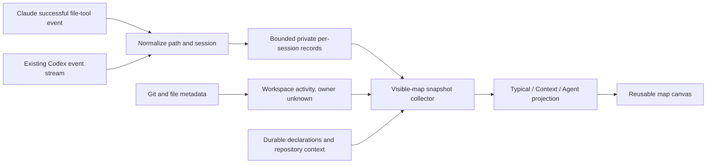

# Reusable maps and lightweight activity snapshots

The map now has three projections over one graph: Typical summarizes every workspace, Context expands the task's inputs, and Agent isolates one agent's execution paths. The next tracking step should consume existing machine events and retain only small path records. It should add **zero model calls and zero injected tracking tokens**.

## Current delivery and the remaining boundary

The application now has a reusable `MapDiagram` layout template, a separate `WorkspaceMapProjection`, and an `InteractiveMapCanvas` renderer. The renderer does not know about the queue, provider sessions, collection, or opening documents. The CLI can export the same positioned diagram the app uses. A project-level collector can reuse these components later.

The current facts are Git workspace paths, registered agent sessions, provided task context, explicit per-agent scope, Markdown link groups, recorded durable tmux instances, and an optional resource manifest. Per-file agent ownership still requires a declaration. **This release does not automatically observe every agent's file reads and writes.** It also does not install provider hooks or alter running agents.

Declared input/output scope older than 30 minutes is hidden from the execution views. “Include older scope” restores it. This is declaration freshness, not proof that a file was recently accessed. Durable resources and provided repository instructions persist. The future event window below should use actual event timestamps instead of repeatedly refreshing an entire declaration.

## Structure and navigation

| View | Visible by default | Entry point |
| --- | --- | --- |
| Typical | Task context slots, workspace containers, root repository context, agents, compact output directories, durable instances | Initial map; Typical button |
| Context | All available context documents, heading representatives, expanded source links | Context workspace header, Focus Queue node, Context button |
| Agent | One agent, relevant input files, output hierarchy, related durable instances and explicit feedback | Single-click an agent |

The Focus Queue and its context workspace remain outside worktree containers. The workspace has Central plan, Task context and evidence links, and Task map slots. Context sources funnel into the evidence slot. Execution containers enclose agents and their file trees. Feedback and handoff edges may form cycles; physical containment may not.

Typical folds output files to their parent folder. Expanded exposes file leaves, with five or fewer files per folder. Larger folders stay represented by a folder and an expansion button until opened. A heading in an input Markdown document represents its links; opening that heading reveals clickable link nodes. Single-child directory chains compress into breadcrumb labels. Parent cards share their descendants' vertical span. Layout is deterministic, with no force simulation, and recomputes only the visible projection.

Code remains selectable plain text in the document pane. The metadata strip shows its path, type, size, modification date, and an explicit Show in Finder action. Existing static document preview is retained; richer code and PDF features remain separate work.

## Research findings

**Claude Code:** a successful `PostToolUse` event includes the tool name, session identity, arguments, and response. File-tool arguments provide paths. An async command hook can run while the agent continues; it must emit no context or behavior-changing output. Tool-specific hooks miss writes performed through shell commands. Each invocation creates a process, so the adapter must do only a bounded local write and enforce its own short deadline. These observations support a metadata-only collector, not a prompt hook. [Official hooks reference](https://code.claude.com/docs/en/hooks#posttooluse), [background hooks](https://code.claude.com/docs/en/hooks#run-hooks-in-the-background).

**Codex:** the local installed CLI supports `exec --json`. The existing Focus Queue harness already requests it, so managed runs can reuse that stream. Official documentation identifies item events for file changes and command execution. The SDK defines structured file-change paths and completion status. This supports precise successful write events; a shell command alone does not prove which files it read. [Non-interactive events](https://developers.openai.com/codex/noninteractive/#make-output-machine-readable), [official SDK item types](https://github.com/openai/codex/blob/main/sdk/typescript/src/items.ts).

**Local implementation finding:** the current Python harness gathers process output before processing it. Adapting it for live snapshots requires incremental stream consumption while preserving the current final response, timeout, failure logging, and cancellation behavior. Retrofitting arbitrary interactive terminals through transcript scans would be a separate, less stable approach and is excluded from the first adapter.

**Inference and recommendation:** use provider events for agent attribution and filesystem metadata for unattributed workspace changes. Filesystem modification times cannot establish reads or identify the writer when agents share a worktree. A Git diff only establishes divergence from the index. Neither should create an agent ownership edge.

## Proposed event contract

```json
{
  "version": 1,
  "taskID": "TASK-ID",
  "workspaceID": "stable-git-identity",
  "provider": "codex",
  "sessionID": "registered-session-id",
  "eventID": "provider-item-id",
  "occurredAt": "2026-09-14T18:00:00Z",
  "operation": "write",
  "path": "/absolute/worktree/path/Feature.swift",
  "source": "provider-tool-event",
  "successful": true
}
```

Read/write/delete events retain paths and provenance only. Exclude file contents, shell output, prompts, reasoning, credentials, and arbitrary tool payloads. Bind to the exact registered session and task so an agent reassignment cannot inherit another agent's recent files. Deduplicate by session/event/path/operation, keeping the newest successful event per key. Preserve an unknown category rather than guessing ownership or success.



## Snapshot and resource budget

Proposed defaults to validate during adapter work:

- No new model requests. Hook stdout stays empty; no tracking instructions are injected into the agent's context.
- At most one coalesced metadata write per session per second. A small record store retains up to 500 recent paths per session, with a one-hour retention cap. Use private atomic replacement or per-session append plus bounded compaction; never a lock shared with the chat backend.
- Collection while visible every five seconds. Closing the map cancels its task; hidden, minimized, or fully obscured windows skip collection. Reopening uses the last snapshot while awaiting the next visible refresh.
- Snapshot includes the most recent 30 minutes of successful per-path activity. A selectable wider window can recover older paths. Reads expire from the active view too, while explicit durable context remains pinned.
- Durable instances carry stable IDs, workspace membership, human-readable summary, and optional evidence document. Their presence is independent of the recent-file window. Show last observation and unknown availability unless an explicit adapter supplies evidence. No automatic service probes or deployment actions.
- Current safeguards: 400 baseline Git paths per workspace, 180 visible diagram cards, 20 local Markdown inputs of at most 128 KB each, and at most 400 added source-group/link nodes per snapshot. These are capacity bounds, not guarantees of rendering every repository file.
- Performance targets for the next adapter: under 10 ms for record normalization/persistence, under 100 ms for a warm projection on a representative multi-agent fixture, and no background Git or parsing work while hidden. Measure before promising these targets in the UI.

## Implementation sequence

1. Define and test the event normalizer with recorded, sanitized fixtures. Cover unsuccessful writes, repeated events, reused sessions, late events, file deletion, rename, and clock skew.
2. Add a tee to the existing managed Codex JSONL reader. Keep final output and failure semantics unchanged. Prove that disabling capture gives byte-equivalent agent prompts and does not delay a slow request.
3. Add a local Claude command-hook adapter that extracts only supported file-tool paths, enforces its own deadline, fails open, and emits nothing. Install only through the app's managed launch configuration, after the adapter is reviewed and provider-version compatibility is checked.
4. Reduce records into visible snapshots. Merge unattributed Git metadata separately, preserving provenance, time, and exact session identity. Test that old files disappear without deleting durable resources.
5. Add a project collector that namespaces task IDs, workspace IDs, and session IDs, then deduplicates shared worktrees and resources. Reuse the same diagram template and view policy vocabulary.

## Review questions for the next tracking iteration

The proposed default is a 30-minute active window and a metadata-only event store. The first automatic adapter should cover Focus Queue managed Codex runs, followed by managed Claude file-tool events. Arbitrary terminal shell reads, external services, and historical transcript reconstruction remain outside that first adapter. Feedback loops stay explicit until a test or deployment adapter can report their endpoints reliably.
