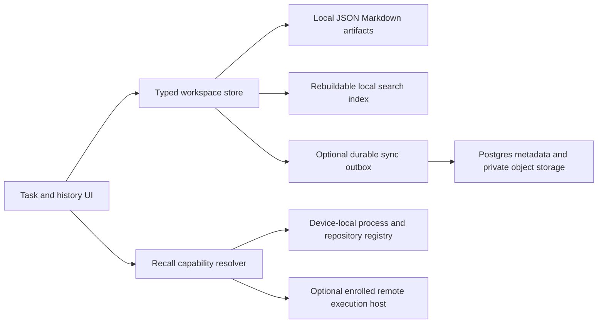

# Durable history should work locally and travel through an optional hub

TL;DR: Make a user-owned folder of versioned JSON, Markdown, and retained artifacts the first reliable storage mode. Introduce stable workspace, task, conversation, and agent-session identities now. Add Supabase as an optional authenticated synchronization hub after local export, restore, and recall work reliably. Keep process execution and provider credentials device-specific.

Date: 2026-09-13. This architecture is based on the current checkout and official documentation. No cloud project, database, account, repository, or remote service was provisioned.

## Implementation checkpoint: local schema and managed runtimes are running

The local phase is implemented in `DurableLibraryStore`: stable workspace, task, subtask and session IDs; installation-scoped provider identities; retained assignment history; device-specific execution locators; repository mappings; document revisions; report runs; conversation retention; migration warnings; and validated export/restore. The app and CLI capture updates alongside the current operational stores. See [the local library guide](LOCAL_LIBRARY.md) for commands and current limits.

Execution uses each user's installed, signed-in CLI and personal subscription. New app-created agents use a dedicated tmux session by default or an optional terminal-owned session. Focus Queue persists the exact selected runtime, and recall only focuses or reattaches that runtime. Provider resume commands and transcript reconstruction have been removed from current recall. The provider session ID remains durable history metadata. Documentation includes central plans, user guides, persistent architectural explanations and compact source-backed module cards.

The live queue can be cleared after current state and task contexts are retained in the library and task snapshot archives. The cleanup removes current agent and subtask entries and acknowledges stale registrations. It does not terminate processes.

The longer-term tables below describe an optional synchronized hub. Cloud storage must not turn a historical provider ID into a claim that a process, checkout, credentials or tool state is live. Remote control should route to an enrolled online host and attach to the same managed runtime. An ended session can later support an explicit successor workflow with a new identity, never an automatic fallback.

## Contents

- [The current records need a durable identity boundary](#the-current-records-need-a-durable-identity-boundary)
- [Recall should expose what is actually recoverable](#recall-should-expose-what-is-actually-recoverable)
- [One schema can support local files and a cloud hub](#one-schema-can-support-local-files-and-a-cloud-hub)
- [Local files should remain a complete supported mode](#local-files-should-remain-a-complete-supported-mode)
- [Supabase is a practical optional hub](#supabase-is-a-practical-optional-hub)
- [Synchronization needs explicit conflicts and offline semantics](#synchronization-needs-explicit-conflicts-and-offline-semantics)
- [GitHub documentation is a publishing integration](#github-documentation-is-a-publishing-integration)
- [Permissions and recovery belong in the storage contract](#permissions-and-recovery-belong-in-the-storage-contract)
- [Migrate and ship in stages](#migrate-and-ship-in-stages)
- [Do next](#do-next)

## The current records need a durable identity boundary

| Current evidence | Portability consequence |
| --- | --- |
| [TaskAgentSession](/Users/hira/Documents/Github/ECCFocusQueue/Sources/FocusQueueCore/Models.swift:1062) stores a UUID, ticket ID, provider, provider session ID, absolute working/context/support paths, and window/tab/pane IDs together. | Durable identity and temporary execution locators are mixed. Restoring a record on another machine cannot validate those locators. |
| `LocalState.upsertAgentSession` in the same source matches provider plus case-insensitive session ID and replaces the prior association. | It lacks provider-account/device namespaces and an independent task-assignment history. Attaching a session elsewhere should preserve where it previously worked. |
| [TaskContext](/Users/hira/Documents/Github/ECCFocusQueue/Sources/FocusQueueCore/TaskContext.swift:77) has schema version 1, task/subtask metadata, absolute plan/worktree/repository paths, and explicit heartbeats. | Preserve task identity and progress across storage modes; resolve paths through a device-local repository mapping. A historical heartbeat cannot prove that a process is alive now. |
| [QueueConversationStore](/Users/hira/Documents/Github/ECCFocusQueue/Sources/ECCFocusQueue/QueueConversationStore.swift) saves the last 500 app-chat messages and a plan-edit draft. | This is app conversation history, not a provider transcript archive. The 500-message cap should become a display/cache bound rather than silent loss of durable history. |
| [TaskContextStore snapshots](/Users/hira/Documents/Github/ECCFocusQueue/Sources/FocusQueueCore/TaskContext.swift:429) independently copy plan/context content and retain 100 snapshots. | Good recovery groundwork, but older versions can expire. A symlink in a worktree remains a pointer rather than a backup. |
| [DailyReportHistory](/Users/hira/Documents/Github/ECCFocusQueue/Sources/FocusQueueCore/DailyReportHistory.swift:45) separates report archives from viewed/run presentation state; reports have run IDs, time bounds, source coverage, and token usage. | Keep that separation. Share report content when selected; maintain per-user read position independently. |
| [AgentRegistrationInbox](/Users/hira/Documents/Github/ECCFocusQueue/Sources/FocusQueueCore/AgentRegistrationInbox.swift) acknowledges transient registration files after import. | Registration transport cannot serve as the durable session catalog. Import must succeed durably before acknowledgement. |

The immediate contract should be: closing, detaching, or losing a terminal changes availability, while the task's historical agent record and retained evidence remain available. A task can have many agent sessions. A session can contribute to several tasks over its lifetime; preserve those assignments with start/end times.

## Recall should expose what is actually recoverable

| User action           | Required evidence                                                                                                   | What it restores                                                                             |
| --------------------- | ------------------------------------------------------------------------------------------------------------------- | -------------------------------------------------------------------------------------------- |
| View history          | Retained messages, plan revisions, and artifacts.                                                                   | A readable record on any authorized device, with no agent launch or token use.               |
| Focus running session | Matching enrolled host and exact verified managed tmux identity.                                                    | Focus an attached client or attach a new client to the same process.                          |
| Open on another Mac   | A reachable, enrolled host and explicit permission to control that session.                                         | A request to the original execution host. The process stays there.                            |
| Start successor       | Retained task plan, evidence, repository revision, provider account checks and a deliberate new-run request.         | A new managed provider session linked to its predecessor and clearly labeled as a successor.  |

Provider-native continuation may be evaluated later for an explicit successor workflow. It is outside current recall and cannot establish that the original process or workspace still exists.

Claude documents local transcript storage, configurable retention, and export interfaces. Its internal transcript format can change between versions; a text export preserves readable history but is not a guaranteed native import format. The documented default transcript retention is 30 days and can be configured, so Focus Queue must not promise permanent recall from provider files alone. [Claude session documentation](https://code.claude.com/docs/en/sessions).

A database row cannot preserve shell jobs, process memory, open file descriptors, terminal scrollback, native provider authentication, uncommitted repository changes, or an expired execution environment. tmux or a remote host can keep an execution environment alive while that host remains available; backing up the task library solves a different problem.

## One schema can support local files and a cloud hub

Use app-generated UUIDs for primary identity, created offline. Human labels such as ECC-040 are workspace-scoped aliases, never global primary keys. Preserve provider IDs as opaque strings; normalize only when the provider adapter explicitly defines that normalization.

| Entity                           | Core fields and identity                                                                                                                                                                                                         |
| -------------------------------- | -------------------------------------------------------------------------------------------------------------------------------------------------------------------------------------------------------------------------------- |
| Workspace                        | `workspaceID`, name, schema version, storage mode, optional cloud binding. A personal local workspace exists without a cloud login.                                                                                              |
| Task and subtask                 | `taskID`, `workspaceID`, display key, optional parent ID, status, criteria, current document ID, revision. Preserve existing ticket keys through an alias map.                                                                   |
| Agent session                    | `agentSessionID`, provider kind, provider-native session ID, `providerAccountRef`, originating provider installation ID, created/ended times, predecessor session ID, transcript availability.                                   |
| Task assignment                  | `assignmentID`, task/subtask ID, agent session ID, role, associated/disassociated times. Detachment ends an assignment or availability link; it does not delete the session.                                                     |
| Provider account                 | App-owned opaque reference, provider, optional verified provider principal/organization ID, user-visible alias, verification state. Credentials stay in the device secret store. Unknown identities remain unknown.              |
| Device and provider installation | Random device-installation UUID, human label, platform, provider-installation UUID, provider/version metadata. A restored library on a new machine gets a new device identity.                                                   |
| Execution locator                | `executionID`, agent session ID, device ID, boot/process incarnation, terminal adapter and instance, pane/window IDs, local repository mapping, observation time, availability/lease state. Local-only by default.               |
| Conversation and event           | Conversation ID, task/session links, message/event UUID, actor, role, sequence within its stream, timestamp, optional parent event, payload/artifact reference. App chat and provider transcript streams remain distinguishable. |
| Document and revision            | Stable document UUID, title, media type, immutable revision ID, content digest, parent revision IDs, task links, originating source. A file rename preserves document identity.                                                  |
| Report run                       | Run UUID, scheduled logical date and timezone, schedule ID, execution attempt ID, started/finished times, outcome, source/account coverage, usage, immutable report document ID.                                                 |
| Artifact                         | UUID, workspace, type, size, checksum, storage reference, provenance, privacy class, retention policy, available/missing/redacted state. Include logs, replies, evidence, images, and imported transcripts.                      |
| Repository binding               | Repository UUID, optional verified hosting-provider repository identity and URL, branch/commit references; separate per-device checkout/worktree mapping.                                                                        |
| Sync operation                   | Operation UUID, originating device, entity ID, expected revision, typed change, schema version, acknowledgement state.                                                                                                           |

Three identities are independent: the person signed into Focus Queue, their workspace membership, and their account at an agent or connector provider. A shared workspace must not automatically grant use of another member's provider account. Never infer identity by hashing or exporting credential material.

Initially, scope unknown native sessions by provider installation plus opaque native ID. Merge cross-device/account records only after an adapter or an explicit reconciliation establishes that they identify the same session. Keep uniqueness constraints and foreign keys workspace-scoped to avoid accidentally linking another tenant's task or artifact.



The store owns mutation validation in either mode. Cloud changes are data; they never implicitly become executable shell commands, provider prompts, or task-completion authority.

## Local files should remain a complete supported mode

Proposed library layout, independent of the user's home-directory name:

```text
FocusQueueLibrary/
  library.json
  workspaces/<workspace-id>/
    workspace.json
    tasks/<task-id>/task.json
    tasks/<task-id>/plan.md
    sessions/<session-id>/session.json
    conversations/<conversation-id>/segments/
    documents/<document-id>/revisions/
    reports/<run-id>/report.json
    artifacts/<artifact-id>/
    operations/<operation-id>.json
  local/<device-id>/repository-mappings.json
  local/<device-id>/execution-locators.json
  cache/search.sqlite
```

This layout is proposed, not an existing on-disk format. Users may choose a library folder. JSON and Markdown remain readable without the app. A SQLite search/index cache is optional and disposable; all authoritative data must remain recoverable if that cache is removed. The local mode requires no Postgres service, cloud account, or model call.

Start with existing atomic file writes and advisory locks. Add record revisions, a recoverable operation journal for changes spanning multiple files, and immutable document/artifact versions. Write referenced bytes before publishing a record that claims they are present. Crash recovery must either replay a complete operation or retain the prior valid revision. An interrupted journal entry cannot become an accepted task transition.

External Markdown edits remain supported: observe content changes, compare the prior revision, import a new revision, and preserve conflict copies when both editor and app changed the document. Relative document references resolve inside the library or through explicit repository bindings. Use document IDs for in-app navigation and a portable relative-link export for external Markdown readers.

A generic file-sync folder may produce duplicates and concurrent edits. Qualify that use separately. Never assume that a live shared SQLite file, shared lock, or shared terminal locator becomes safe because the parent folder is synchronized.

## Supabase is a practical optional hub

Recommendation: retain the local library as the working copy, and offer “Sync this workspace” through an optional managed Supabase project. Use PostgreSQL for relational metadata, revisions, membership, and operations; private object storage for larger transcript segments and artifacts. A small Markdown document can live inline or in object storage, but choose one canonical representation per revision.

Supabase supplies Postgres plus authentication, object storage, and realtime services, reducing separate backend components. Its [Swift client](https://supabase.com/docs/reference/swift/introduction) covers database, Auth, Storage, and realtime operations. That is a practical fit for this Swift app; the synchronization and conflict semantics described below still belong to Focus Queue.

| Choice | Appropriate use | Remaining work |
| --- | --- | --- |
| Local files only | First release, private single-user work, no account needed. | Revisions, retention, backup/export, robust recall, and search. |
| Local files with Supabase hub | Selected workspaces shared across devices or members. | Auth UX, tenant policies, storage policies, durable sync, conflict UI, offline operation, billing/quotas, and restore drills. |
| Plain Postgres with a custom API | Teams that need an existing infrastructure stack or detailed server control. | Implement authentication, authorization, API, object storage, subscriptions, operations, and deployment. A desktop client should not receive an unrestricted database password. |
| Self-hosted Supabase | Later deployment option for qualified administrators. | Updates, observability, backups, secret rotation, storage, and operational support. It is not the zero-setup local mode. |

[Supabase Realtime](https://supabase.com/docs/guides/realtime) provides broadcasts, presence, and database-change notifications. Treat notifications as hints to refresh the authoritative change feed, rather than as the only copy of a change. Supabase also lists a [PowerSync integration](https://supabase.com/partners/integrations/powersync) for Postgres-to-local-SQLite synchronization. Evaluate such a layer in a separate prototype if manual sync becomes complex; check its Swift support, operation semantics, licensing, and operational costs before adopting it. It would change the local replica implementation, not eliminate identity, authorization, or document conflict decisions.

For a first cloud prototype, begin with append-only reports, retained messages, and read-only remote task/history views. Multi-device editable plans and execution control are later gates. Measure stored bytes, transfer volume, realtime fan-out, and retention before selecting a paid plan; this document makes no price or capacity promise.

## Synchronization needs explicit conflicts and offline semantics

Local mutations first persist an operation UUID, expected entity revision, and typed change. A durable outbox retries until the server records the result. The server validates membership and operation permissions, applies each operation once, and returns the resulting revision. Replaying the same operation returns the previous result instead of duplicating work. A transactional server function or API can enforce this boundary; Supabase supports [Postgres functions](https://supabase.com/docs/guides/database/functions).

Use a workspace-scoped committed change cursor and explicit deletion tombstones. Generate a transactionally ordered feed, for example by serializing a workspace revision counter inside the commit transaction. A timestamp or a freely allocated sequence number alone is unsafe as a high-water mark when transactions can commit out of order. Initial download must bind a consistent snapshot to a cursor; reconnect fetches changes after the last acknowledged cursor. Expired cursors trigger a full reconciliation while preserving unsent local operations.

| Data                                     | Conflict rule                                                                                                                                             |
| ---------------------------------------- | --------------------------------------------------------------------------------------------------------------------------------------------------------- |
| Messages, reports, review evidence       | Append immutable records; deduplicate by stable operation/message/run identity. Conflicting payloads for the same immutable ID are quarantined.           |
| Task title/type/priority/criteria        | Compare expected revision; merge independent fields only when a validated rule proves independence. Same-field disagreement becomes an explicit conflict. |
| Plan Markdown                            | Three-way merge using the shared base revision; preserve both versions when overlapping edits cannot merge cleanly. Real-time coediting/CRDTs can wait.   |
| Completion, account scope, access grants | Server/host predicates and authorization. Never silently choose a last writer for security or completion transitions.                                     |
| Per-user read position/preferences       | User-scoped records, with a documented merge rule; another member opening a report does not mark it read for everyone.                                    |
| Process liveness                         | Device observations with expiry. A device becoming unavailable means availability unknown, not completed or failed.                                       |
| Deletion                                 | Tombstone plus retention window. Offline updates to a deleted object surface a conflict instead of resurrecting it automatically.                         |

An offline user can read the cached library and make permitted local edits. The UI shows pending sync and conflicts honestly. Revoked membership blocks server writes when the device reconnects; already downloaded bytes cannot be remotely guaranteed to disappear from an offline device. Preserve unsent work in a private export/quarantine rather than leaking it to a different workspace after account switching.

Duplicate scheduled reports need a logical schedule/date/timezone key plus an execution attempt ID. A server lease with expiry can coordinate hosts, but external provider execution cannot be made exactly-once just by writing a database row. Persist start/acknowledgement state and treat ambiguous interrupted launches as “check existing run,” avoiding blind duplicate token spending. Local mode initially assigns scheduled execution to one chosen device.

## GitHub documentation is a publishing integration

Support an optional user-selected documentation repository per workspace, with readable central plans, approved report summaries, decisions, and evidence links. Use stable relative paths and record repository identity, document path, branch, and commit SHA in document bindings. Multiple tasks can share a repository; a repository per task adds setup overhead without fixing identity.

Choose an explicit writable authority for each document: either the library/cloud revision stream, with Git exports and reviewed imports, or a Git-managed document imported through revision-aware synchronization. Do not allow two background writers to silently overwrite one another. A Git commit can preserve a document revision; a branch name alone cannot identify the historical content a notification referred to.

Keep provider credentials, private inbox bodies, raw diagnostic logs, and execution locators out of automatic documentation exports. Raw transcript archives and large attachments belong in the selected private artifact store. GitHub has [file-size and repository guidance](https://docs.github.com/en/repositories/working-with-files/managing-large-files/about-large-files-on-github), and deleting sensitive text from the latest file does not remove its Git history. [GitHub's sensitive-data removal guidance](https://docs.github.com/en/authentication/keeping-your-account-and-data-secure/removing-sensitive-data-from-a-repository) explains the additional recovery work.

The product can suggest or prepare a repository export locally. Creating a remote repository, pushing documents, changing visibility, or publishing personal evidence remains a distinct explicit action.

## Permissions and recovery belong in the storage contract

Cloud tables need `workspace_id`, authenticated membership checks, and appropriate constraints. Use owner/editor/viewer roles initially, with artifact privacy separate from task membership for personal mail or transcript material. Policies must cover reads, inserts, updates, and deletes; include workspace consistency across references. Supabase documents combining Auth with [row-level security](https://supabase.com/docs/guides/database/postgres/row-level-security). Validate ordinary-member and cross-workspace requests with hostile fixtures, not only administrator credentials.

Object buckets stay private. Enforce the same workspace/artifact permission rules for uploads, download URLs, and deletion; guessing an object path must grant nothing. Supabase Storage provides [policy-based access control](https://supabase.com/docs/guides/storage/security/access-control). Keep privileged service credentials on trusted servers. Enforce allowed field changes and task transitions in typed server operations, since membership alone is too broad for those actions.

Store cloud refresh tokens and provider credentials in device secret storage. A synchronized provider-account reference is metadata, not a portable login. Reauthentication and permissions must be rechecked on a new device and after account switches. Raw transcript upload is opt-in with an explicit retention choice. If client-side end-to-end encryption is required, decide it before cloud search and sharing APIs: key recovery, device enrollment, server search, and previews all change. Do not advertise it until implemented and tested.

Recommended retention policy: preserve task records, approved plans, decisions, final replies, and completion evidence until the user deletes them. Keep long conversations in immutable segments with bounded loading, rather than truncating the stored corpus at 500 messages. Let users choose raw-provider transcript import and retention; show export age, partial capture, missing native state, and redaction. Pinned task evidence must not disappear during terminal cleanup or ordinary cache eviction. Content digests support corruption checks and deduplication within the authorized workspace; they are not proof of authenticity.

An export should include a versioned manifest, identity maps, selected JSON/Markdown records, required artifact bytes, checksums, and unavailable-artifact markers. Exclude secrets and active execution locators by default. Import into a new library first, verify checksums and references, remap device paths explicitly, and preserve the original export. Reject archive path traversal, symlinks escaping the destination, and oversized/decompression-bomb entries.

Cloud recovery requires both metadata and object backups: [Supabase explicitly excludes Storage object bytes from database backups](https://supabase.com/docs/guides/platform/backups). Test restoring both to a separate environment. A SQLite index can be rebuilt; if any later replica database contains authoritative unsent operations, use its [supported backup mechanisms](https://www.sqlite.org/backup.html) rather than copying a live database incompletely. Optional [Git bundles](https://git-scm.com/docs/git-bundle) preserve Git object history and refs; uncommitted files and external artifacts require their own capture.

## Migrate and ship in stages

| Stage                            | Concrete work                                                                                                                                    | Exit evidence                                                                                                                                                  |
| -------------------------------- | ------------------------------------------------------------------------------------------------------------------------------------------------ | -------------------------------------------------------------------------------------------------------------------------------------------------------------- |
| 1. Reliable local recall         | Separate historical association from live terminal availability; show history without launch; preserve the session after terminal disappearance. | Restart, stale/reused pane IDs, detached session, missing transcript, wrong account, and missing worktree fixtures.                                            |
| 2. Durable identities and export | Introduce workspace/task/session/account/device IDs and alias mappings; independent execution locators; lossless export/import.                  | Round-trip existing state, reports, plans, drafts, and associations into a new user home with no silently dropped records.                                     |
| 3. Retention and library mode    | User-owned folder, journaled revisions, segmented conversations, retained final replies, conflict handling, searchable artifacts.                | More than 500 messages and 100 plan versions remain recoverable under selected retention; interrupted write, low disk, external edit, and index rebuild tests. |
| 4. Optional cloud history        | Supabase prototype with Auth, tenant policies, private objects, outbox/feed, and read-only second-device views.                                  | Offline replay, duplicate operations, missed notifications, account switching, cross-tenant denial, and full metadata/object restore.                          |
| 5. Multi-device edits and Git    | Revision-aware edits, Markdown conflicts, report scheduling coordination, explicit Git export/import.                                            | Two devices edit offline; no silent loss, accidental resurrection, duplicate scheduled spending, or unrequested publication.                                   |
| 6. Qualified remote recall       | Enrolled execution host, authenticated action requests, fresh grants, adapter/account/checkout verification.                                     | Replayed/stale requests rejected; history remains usable when the host is offline; a new continuation is never presented as the original process.              |

Migration must be resumable and idempotent: back up current files, scan and validate, generate stable ID mappings once, copy into a staging library, validate counts/digests/references, then atomically switch the active-library pointer. Keep old files until the restore check passes. Missing provider-native transcripts are marked missing, not invented. Unsupported future schema versions open read-only and preserve raw data. A downgrade must not rewrite unknown fields or erase newer objects.

## Do next

1. Finish the current local recall fix and preserve agent associations independently of terminal liveness.
2. Implement versioned identities and a lossless local export/restore path before choosing a production cloud plan.
3. Prototype Supabase synchronization with reports and readable history, then qualify editable plans and remote execution separately.
