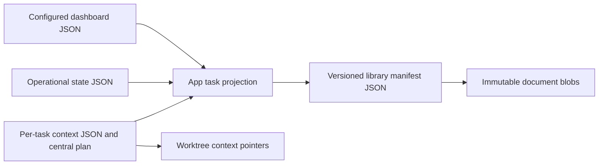

# Focus Queue roadmap

Build the task-based tmux organizer first, alongside the reliability fixes needed to use it.

September 17, 2026 · ECC-035. This backlog defines intended outcomes; completion requires delivery evidence. Rows are proposed subtasks. Focus Queue is the only active project.

## Current delivery: sessions that stay findable

| Deliverable | Reviewable outcome |
| --- | --- |
| Launch reliability | New Agent shows progress and actionable errors, retains inputs after failure, and retries the saved assignment safely. Distinguish requested, running, waiting, stopped, and unknown runtime state. |
| Task session organizer | Each task owns its tmux session and agent panes. The app shows that structure and recalls verified panes. Default to one terminal window per task; preserve existing conversations and terminal setups. |
| Pane sizing and control | Fit readable panes to usable terminal dimensions. Reflow after window or monitor changes; place overflow in additional tmux windows. Preserve manual control. Evaluate open-source navigation and mouse rearrangement before promising drag and drop. |
| Persistence and recovery | Integrate tmux-resurrect and tmux-continuum with visible save/restore health. Test restored identity and explicit provider conversation resume. A layout snapshot does not prove that an agent process survived a restart. |
| Workspace safeguards | Validate the assigned checkout and branch; flag shared workspaces. Refuse app bundles or replaced worktree identities. Keep explicit user workspace choices and preserve other agents' files. |
| Completion and task details | Make details load reliably, show the relevant subtask and agent, and expose short completion reasons. Review dismiss/hand-off actions and prevent repeated nagging after acknowledgement. Verify side-by-side prompt state. |

Acceptance evidence: headless regression tests, recorded fixes, cohesive commits, and an installed build for manual assessment. UI automation requires explicit opt-in. Record completion separately for each deliverable.

## Near-term deliverables: structure before more automation

| Deliverable | Scope and decision |
| --- | --- |
| Project layer | Add Project → Task → subtasks, sessions, and worktrees. Replace the hardcoded app title with the selected project and a switcher. Preserve existing task IDs and history during migration. |
| Alternate views | Keep task grouping as default. Add worktree/branch filters and a plain worktree/branch file tree. These are views of the same ownership model. |
| Worktree lifecycle | Show branch, base commit, workspace history, and active users. Nudge against unnecessary worktrees. Remove only app-owned, validated, clean, safely integrated worktrees; retain branches and context. |
| Completion agreement | User and agent define success. Suggest tests/CI, commits, and PR evidence. The proposed baseline still requires task-specific closure and cleanup rules. |
| Orchestrator | Decompose objectives, automate repeatable task creation, detect scope/workspace conflicts, and maintain internal handoff notes. Keep central plans and task details findable. |
| Everyday controls | Add discoverable hotkeys for new agent, project switching, focus, and pane/task navigation. Add cleanup scoped to a selected task with clear affected-agent visibility. |

## Current data storage: JSON and retained document bytes

Default support root: Application Support under `ECC Focus Queue`, overridable with `FOCUS_QUEUE_SUPPORT_DIR`. The dashboard can live elsewhere.

| Location within support root | Responsibility |
| --- | --- |
| `config.json`, `state.json` | App configuration, queue preferences, registered sessions, completion review state. |
| `tasks/<ticket>/context.json`, `plan.md` | Task/subtask assignments, workspace/runtime references, current central plan. |
| `tasks/<ticket>/archive/` | Retained task context and plan snapshots. |
| `library/manifest.json`, `library/blobs/` | Durable task/session/assignment identities, repository mappings, document revisions, report history, retained bytes. |
| `library-device.json` | Installation identity, kept separately from portable library exports. |
| `logs/agent-launches/` | Structured launch diagnostics. |

Code references: [AppPaths](/Users/hira/Documents/Github/ECCFocusQueue/Sources/ECCFocusQueue/AppPaths.swift), [operational persistence](/Users/hira/Documents/Github/ECCFocusQueue/Sources/FocusQueueCore/Persistence.swift), [task context](/Users/hira/Documents/Github/ECCFocusQueue/Sources/FocusQueueCore/TaskContext.swift), [durable library](/Users/hira/Documents/Github/ECCFocusQueue/Sources/FocusQueueCore/DurableLibrary.swift).

Durable history uses atomic JSON and checksum-addressed blobs. SQLite is absent from the inspected Swift implementation. Start projects with existing contracts; evaluate a database/index against measured needs.

## Management rules

1. Organize by objective; agent, branch, worktree, and device are supporting identities or filters.
2. Scope every launch, update, recall, and cleanup to an explicit task and verified workspace/runtime.
3. Preserve concurrent edits. Surface conflicts; never silently redirect an agent or switch its branch.
4. Keep saved conversation, live process, progress heartbeat, and completion as separate facts.
5. Automation assists user control. Preserve manual layouts and explicit choices; make uncertain state visible.
6. Use short, plain copy. Sanitize input, show evidence, and retain decisions without repeated notifications.

## Parked until the current delivery is usable

ECC context profiles and the auto-feature draft; DB-schema specialist/Kairos pipeline; a replacement terminal or IDE; session wrapper UI; optional cross-task dynamic grouping; map-first navigation; visual redesign; multi-computer orchestration.
