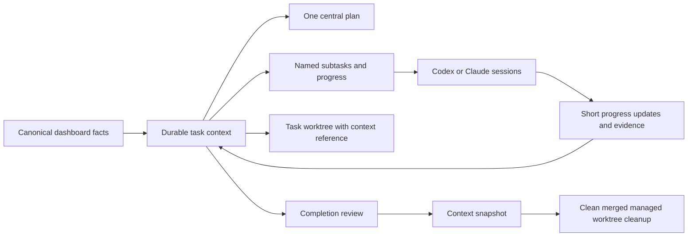

# Focus Queue orchestration redesign

Status: implemented and verified on September 10, 2026.

## Product intent

Make one task understandable at a glance, give every agent the same durable context,
and make progress and closure explainable. Existing dashboard facts and unfinished
repository changes remain authoritative inputs.

## Context architecture

Each task has a canonical folder under the app's Application Support directory:
`tasks/<ticket-id>/`. It owns a central `plan.md`, structured task and subtask
context, and archival snapshots. A worktree contains a `.focus-queue/<ticket-id>`
reference and a live plan link for agent discovery. Independent archive copies
preserve the document without creating competing editable versions. The canonical plan survives branch
switches, worktree deletion, and app restarts. Additional source plans remain
linked from the central plan. Agent launch prompts point directly at the task
folder and the current worktree reference.

This local central store avoids committing private orchestration state into every
repository and prevents deleting the only copy during cleanup. A worktree-only
store would make resumed agents and retrospective review depend on an ephemeral
checkout. Durable snapshots also let us preserve context before cleanup. The
tradeoff is that moving to a different computer requires exporting the task store;
cross-device sync is a future explicit capability.

## Interface hierarchy

The narrow queue remains the navigation rail. A task card presents its title,
short explanation, central-plan action, progress, named subtasks, and secondary
evidence in that order. Opening a plan expands the panel inward from its edge.
The document and task-aware orchestrator conversation remain available together;
closing the document returns to the compact queue.

Subtask rows show meaningful names, provider, current state, and last progress.
Clicking a row focuses or reattaches its exact managed agent runtime. New agent provisions or
reuses the task worktree and launches with a concrete assignment. Terminal labels
keep the repository-mandated ticket/provider/session format; readable assignment
names live in the app. Work status requires a fresh agent report and expires to
idle, rather than treating an open terminal as proof of activity.

Queue conversation uses full-width output blocks with role labels. Agent output
uses a darker neutral surface; user instructions use a lighter neutral surface
in both light and dark appearances.

## Implementation sequence and acceptance checks

| Area | Intended behavior | Sanity verification |
| --- | --- | --- |
| Durable context | Every task gets a central plan; existing plans stay linked; context survives restart and archive | Temporary-directory persistence, idempotent plan generation, archive and path-validation tests |
| Worktrees and launch | One worktree per task, named subtask per agent; launch passes paths and prompts as arguments | Fake process-runner command checks and disposable Git repository lifecycle tests |
| Progress and closure | Short durable status updates, stale heartbeat handling, completion dots, review feedback | State transition and restart tests; closure guards reject dirty or unmerged checkouts |
| Embedded plan | Expandable in-app Markdown document, task-scoped conversation, easy close, linked supporting documents | App compilation and renderer/link policy tests; headless model checks |
| Task readability | Short explanation before plan and progress; details available on disclosure | Summary/category mapping tests and source-level UI checks |
| Reports | Running, failed, and unread status at top; expandable report; history and logs in settings | History/read-state/run-recovery/log-tail tests and existing report suite |
| Mail | Correct helper identity and precise denial versus mailbox failures | Connector unit tests, helper syntax/signature inspection, narrow read-only health check |
| Tooltips and appearance | Labels on all top-bar controls; neutral full-width role surfaces | App build and source-level checks in both appearance branches |

## Closure rules

A manual completion request starts the existing bounded verifier. Criteria and
evidence remain visible to the user and orchestrator. Disagreement keeps the
task open and creates a top-level attention item. Archive first. Remove only
an app-managed worktree when clean and its commits are contained in the configured
base branch. Preserve dirty, unmerged, manually attached, or ambiguous worktrees
with a concrete reason. Do not force-delete or silently merge into a user's
active branch. A subtask's reported completion is distinct from verified task
closure.

## Delivery and launch considerations

Run Swift and Python suites, package the release build, and install the requested
app changes. All validation is headless under the repository's interaction rules.
Actual pointer, Settings, window-layout, and Accessibility automation requires the
explicit opt-in environment variable and is outside this verification run.

Before a broad public launch, prioritize signed and notarized distribution,
first-run account/workspace setup, portable paths, context export/recovery,
provider capability detection, resource budgets, and a user-reviewed merge policy.
These are product readiness work, separate from the requested local revisions.

## Implemented contracts

- `TaskContextStore` serializes app and CLI writes with a per-task file lock.
  Plan saves compare the editor's starting text against the current file and
  retain both drafts when another agent has changed it.
- Task conversations use individual persistent Codex sessions. Displayed replies
  stay attached to the initiating task even while the user opens another plan.
- Working status expires after five minutes without an explicit progress report.
  Completed subtasks retain an explicit green unread state until viewed and move
  into collapsed archives on the task and Completed tab. Expand a row for its full
  assignment or use the three-dot menu; use Attach's assignment picker to recover
  an unbound launch.
- The document renderer disables content JavaScript and remote embedded resources.
  Links are opened only after a deliberate user action. Markdown remains editable
  and saved drafts survive closing the inspector and restarting the app.
- Report history keeps selected documents separate from the latest notification.
  Run receipts use the actual returned report ID; failed launches cannot inherit an
  older report. Restart recovery probes the Python worker lock before reporting an
  interrupted run. History loads incrementally and shows bounded log tails.
- Mail's recorded failure was an unconfigured Sent mailbox followed by a sandbox
  denial during process cleanup. Those errors now have their own diagnostics;
  the signed Mail helper's Automation approval was confirmed by a live status check.
  Busy requests have a 15-second queue limit within the total 90-second budget.
  Search retrieves message bodies only for the selected page. The report harness
  accepts dotted Codex feature names and passed the installed Codex 0.154 preflight.

Git cleanup first applies the documented worktree cleanliness and merge checks,
then binds de-registration to the verified worktree inode. The app moves that
directory to a no-follow retained sibling, rechecks tracked, untracked and ignored
content, and moves only its exact Git administration directory out of Git's active
worktree registry. It does not recursively delete checkout files. The branch,
retained checkout and recovery metadata remain available. Locked worktrees,
submodule metadata and incomplete Git administration cleanup remain registered.
[Git worktree documentation](https://git-scm.com/docs/git-worktree).
The embedded renderer uses WebKit's explicit JavaScript policy.
[Apple WebKit documentation](https://developer.apple.com/documentation/webkit/wkwebpagepreferences/allowscontentjavascript).

## Final validation

- 109 Swift tests passed across core behavior, app state, and actual windowless
  WebKit rendering. This includes disposable Git worktree creation, refusal cases,
  merge, archive, removal, and reopening.
- 85 Python tests passed across daily reports, Codex, Mail, and Discord. JavaScript
  syntax and shell syntax checks passed.
- Release compilation and deep strict signature verification passed. The running
  app's installed executable matched the signed release bundle.
- Live Mail status returned verified account and mailbox metadata. The optimized
  installed search returned two verified results without a permission or timeout error. Codex 0.154's
  complete no-tools preflight validated 140 feature controls, seven configuration
  controls, and the effective tool manifest with synthetic local input.
- UI input, Accessibility clicks, pointer movement, and multi-window layout were
  not automated. Final interactive layout acceptance remains a manual check.
- Existing user workspaces and unrelated repository edits were preserved. The
  previous installed app, Mail helper, configuration, and local state were copied
  to a private rollback directory before installation.

## Product follow-ups

1. Replace owner-specific paths with first-run workspace and account setup, then
   establish signed and notarized distribution and update delivery.
2. Add context export/import and recovery checks before introducing cross-device sync.
3. Add per-task token/time budgets and a concise waiting-for-human inbox.
4. Add explicit review/merge policy and file-ownership conflict detection for agents
   sharing a task worktree. Current cleanup deliberately preserves unmerged branches.

## September 11 revisions: launch preferences and responsiveness

Interactive terminal agents now invoke the fixed provider command in the user's
zsh or bash interactive login shell. This preserves aliases, functions, custom
wrapper scripts, and configured flags. Task text remains positional arguments,
never interpolated shell code. Background reports, queue chat, and completion
verification retain their bounded launch policy. Bash follows its normal login
startup rules, including any `.bashrc` sourcing in the login profile; other login
shells currently fall back to zsh.

The installer records a private `agent-shell.json` capability summary from known
profile files. It records customization kinds and source filenames, never alias
definitions or secrets, and executes neither providers nor startup scripts.
Dynamic or additionally sourced definitions are resolved by the real shell at
launch. The scan is diagnostic, not a frozen copy of shell configuration.

New agent has a remembered initialization-prompt toggle. Disabling it submits no
message while retaining the task worktree and context-directory access. That
choice is stored per subtask and also respected on resume. Existing subtasks
default to their original initialized behavior.

The plan and conversation use a horizontal, user-resizable split. The document
sits next to the queue and the conversation extends farther inward. The panel
expands to a preferred 1,440 points from a 440-point queue, clamped to the current
display. On narrow displays the inspector scrolls horizontally while both panes
retain readable minimum widths. Draft persistence and conflict checks are unchanged.

Responsiveness changes target identified work, rather than changing task behavior:

- Accessibility messaging and external window enumeration run on a dedicated
  actor. One final placement replaces 18 resize/move pairs and their 288 ms of
  scheduled sleeps. Unchanged dimensions are skipped. Dismissed or superseded
  focus requests are cancelled; dimming fades and multi-display controls remain.
- Context polling is batched off the main actor. File identity, size, and
  modification time invalidate caches, with a periodic full refresh. Unchanged
  model data does not republish through SwiftUI. Heartbeat expiration still
  invalidates working status when it actually changes.
- Active task collections are lazy. Card shadows render on their background
  shape, and unchanged plan inputs bypass Markdown parsing entirely.

Verification uses synthetic provider aliases/functions, persisted prompt choices,
real windowless WebKit rendering, display geometry, observation regression tests,
and temporary task stores. Interactive perceived latency and pointer-driven
layout acceptance require a manual check; no UI automation is part of this run.
An isolated build directory can be selected with `ECC_FOCUS_QUEUE_BUILD_DIR` when
another development session holds the default SwiftPM build lock.

September 11 delivery verification: all 123 Swift tests in four suites and all
87 Python tests passed. Release compilation and deep strict code-signature checks
passed; the installed app's SHA-256 matches the packaged executable. Installation
detected the user's Codex alias, stored only diagnostic metadata with owner-only
permissions, and restarted the app successfully. The previous app, Mail helper,
configuration, local state, task context, and automation files are retained in
the private `revisions-backup.u0FuuN` folder under Application Support.

The context microbenchmark showed a modest cached I/O improvement (about 12 ms
per 100-task poll on this machine). Its primary verified benefit is zero content
invalidations for unchanged polls and one batched actor return, rather than one
UI update per task. This is not an end-to-end scrolling latency measurement.
