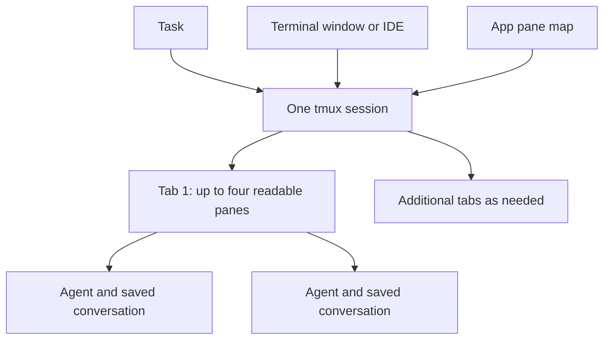

# Task session organizer

New agents share one tmux session per task. The app opens one terminal view onto that task and recalls an agent by its pane identity, even after rearranging panes or closing the terminal view.

## Using it

1. Open a task and choose **New Agent**, keeping **Open in tmux** enabled.
2. Choose **Sessions** in task details, or the terminal button in the queue.
3. Click a pane to open its agent. Drag it onto another pane to swap them, including across the task's tabs. The context menu offers the same swaps without dragging.
4. Use **Arrange to fit** for automatic sizing, or **Keep my layout** for manual control. Resizing a terminal pane border also selects manual control.
5. **Copy attach command** lets the same session open in an existing terminal, IDE terminal or SSH connection to this Mac.

The pane map reflects tmux's current layout. Worktree grouping changes the list inside the selected task. Other terminals remain available in a separate browser.

## Layout and recall



The layout uses terminal cells, with a target minimum of 72 columns and 20 rows per pane and at most four panes per tab. This accounts for font size, window size and monitor changes. A terminal too small for that minimum shows one pane. Extra panes use tmux tabs, which are available in terminals without native tabs.

Available height excludes the actual configured status-bar rows, including multi-row usage bars. Creating a task session also works when the server already contains older per-agent sessions.

Focus Queue currently keeps tmux presentation deliberately plain. The managed usage bar and native tmux window tabs remain visible, while custom pane-border label rows and extra left/right status text are disabled. Agent names remain available in the app's session map and in nonvisual pane metadata.

Client attachment and resize hooks invoke the helper. A size-and-pane signature avoids repeating unchanged layouts. A task lock serializes launches, rearrangement and swaps across the app and helper. Reflow preserves the selected pane and never starts or kills an agent process. A user arrangement remains in effect until automatic layout is selected again.

Pane identity includes the server, session creation time, pane ID, process PID and TTY. Closing an agent kills only that verified pane. An unresolved launch receipt blocks duplicate starts and permits recovery of the original pane. A runtime belonging to another task cannot be opened through a misbound task record.

Existing direct WezTerm sessions and older per-agent tmux sessions remain available. They are not moved automatically. New launches use the task grouping model.

## Saved layouts

Pinned tmux-resurrect and tmux-continuum sources ship inside the application, including their licenses. Saves run every five minutes while detached, and on terminal detach. **Save now** and **Restore saved layout** are available in the session browser. Configuration is scoped to Focus Queue's tmux server.

Restore recreates shells, folders and layout. A reboot ends old agent processes. Open an agent from its task to resume its saved provider conversation in a new pane; restored shells remain available. An agent without a recorded provider conversation requires a fresh assignment. The app does not replay its old initial prompt.

See [persistence design](TMUX_PERSISTENCE.md) for snapshot retention, upstream pins and storage.

## Open-source options evaluated

| Project | What it offers | Fit here |
| --- | --- | --- |
| [tmux](https://github.com/tmux/tmux) | Stable pane IDs, mouse resizing, client size events, join/swap commands and control mode | Runtime and layout authority; the native app supplies task context. |
| [tmux-ui-manager](https://github.com/binara-sachin/tmux-ui-manager) | Mouse-capable popup with drag-and-drop moves between windows and sessions | Useful optional terminal UI and interaction reference. It is not bundled; its unrestricted cross-session moves need ownership integration first. |
| [iTerm2](https://github.com/gnachman/iTerm2) and its [tmux integration](https://iterm2.com/documentation-tmux-integration.html) | Native terminal windows and tabs backed by tmux control mode | Strong option for native terminal manipulation. Users can attach from iTerm2; the app still uses WezTerm for automatic desktop opening. |
| [sesh](https://github.com/joshmedeski/sesh) | Fast session selection and directory-oriented navigation | Useful optional keyboard workflow. It does not supply the app's task and pane model. |

The shipped drag-and-drop interaction lives in SwiftUI and uses verified tmux swap commands. No extra terminal manager or terminal replacement is required.

## Verification and boundaries

Headless tests use disposable tmux servers for pane overflow, reflow, identity retention, selection, manual layout, launch uncertainty, and save/restore. Existing app and Python tests cover launch, workspace, completion and document regressions. UI automation remains opt-in; real mouse interactions and monitor dragging require manual assessment.

The existing-server launch regression is covered by creating an unrelated legacy session before the first task pane. Provider sanity checks must verify an actual Codex session UUID and readiness, rather than treating a live shell or usage-wrapper PID as success. Run the live-agent test suite before committing launch changes or handing them over for manual assessment.

```sh
ECC_FOCUS_QUEUE_LIVE_AGENT_TESTS=1 swift test --filter liveManagedProviderSanity
```

This runs the same New Agent model action for all four worktree and initialization combinations with the installed Codex command. It checks a real response, exact UUID capture, detach/reopen, stopped-conversation resume, and isolated persistence. Only terminal rendering is replaced by a headless tmux control client; mouse/keyboard automation stays disabled.

The project hierarchy, worktree lifecycle automation, broader hotkeys and orchestrator policy enforcement remain in the [roadmap](FOCUS_QUEUE_ROADMAP.md).
