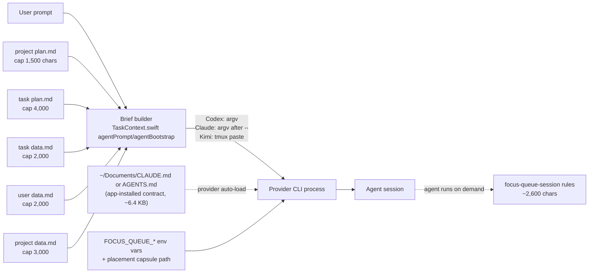
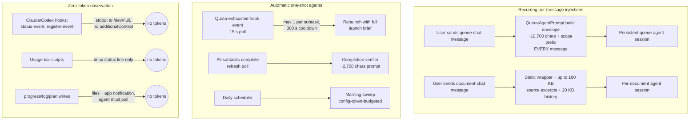

# Token audit: what Focus Queue automatically adds to agent inputs

Scope: only tokens the **app itself** adds to agent inputs — at agent creation and
while an agent runs. User-typed prompts, provider-native system prompts, and
tool-result contents the agent fetches on its own initiative are out of scope
except where the app authored them (e.g. `focus-queue-session rules` output).

Method: fully local counting — file reads, Swift/Python string-literal
extraction, and `focus-queue-session brief|rules` output measurement via
`Scripts/focus_queue_token_audit.py`. **No model is called to observe token
usage.** Token counts use the chars/4 heuristic (bounds chars/5–chars/3); treat
them as estimates within roughly ±25%.

Reproduce any number below:

```bash
python3 Scripts/focus_queue_token_audit.py --task FOC-056 --subtask <AGENT-ID> \
  --price-in 3.0 --report-output audit.md --json-output audit.json
```

## TL;DR

- A fresh managed agent launch costs the app **~950–1,300 input tokens** of
  automatically-added prompt (measured brief: 3,794 chars ≈ 948 tokens for a
  typical task; worst case with all inline caps filled ≈ 4,400 tokens), plus a
  **~1,600-token global contract** that every Claude/Codex session under
  `~/Documents` carries in its system context on **every turn**.
- The single biggest recurring injection is the **queue-chat system envelope**:
  ~10,700 chars (≈ 2,700 tokens) re-sent with **every** queue-chat message.
- The largest single injection is **document chat**: up to ~180,000 chars
  (≈ 45,000 tokens) of inlined excerpts and history per message.
- At Claude Sonnet input rates ($3/M tokens), the app's automatic overhead is
  roughly **$0.01 per agent launch** and **$0.013 per queue-chat message** —
  cents per day in normal use. Prompt caching (billed ~10% of input price on
  repeat prefixes) reduces the recurring parts further.

## Where the tokens are added

### Agent creation



| Component | Source | Chars | Tokens (est) | When |
|---|---|---:|---:|---|
| Global agent contract (Claude) | `Config/CLAUDE_GLOBAL_INSTRUCTIONS.md` → merged into `~/Documents/CLAUDE.md` by `Scripts/focus_queue_install.py` | 6,451 | ~1,613 | every Claude session under `~/Documents`, **resent every turn** |
| Global agent contract (Codex) | `Config/CODEX_GLOBAL_INSTRUCTIONS.md` → `~/Documents/AGENTS.md` | 6,358 | ~1,590 | same, per Codex session |
| Launch brief scaffold, detailed mode | `Sources/FocusQueueCore/TaskContext.swift:440-475` (+ `briefHeader` :494, `dataWritingRule` :423) | 1,291 | ~323 | once per fresh launch |
| Launch brief scaffold, compact mode | `TaskContext.swift:426-436` | 635 | ~159 | once per fresh launch (no detailed instructions) |
| Inlined documents | project plan ≤1,500, task plan ≤4,000, task/user data ≤2,000 each, project data ≤3,000 (`inlineDocument` :518) | ≤12,500 | ≤~3,125 | once per fresh launch, only when files non-empty |
| Measured real brief (FOC-056) | `focus-queue-session brief` output | 3,794 | ~948 | example: typical task with plan + one project-data line |
| Agent rules (pulled, not pushed) | `TaskContext.agentRules()` :545-580 via `focus-queue-session rules` | 2,588 | ~647 | enters context only if the agent runs the command (the brief tells it to) |
| Completed-subtask relaunch template | `TaskContext.swift:443-450` | ~400 | ~100 | reopening a completed agent as a fresh conversation |

Not injected at creation: `agent-log.md` (path only), `Config/ecc.config.json`,
`task-proposals.schema.json` (app-side only). Kimi gets no global contract file;
its brief is pasted into the TUI (`Tmux.swift:256-276`) because `kimi --prompt`
is one-shot mode. Resumed sessions get **no** prompt at all
(`AgentLauncher.swift:202-206`).

### While an agent is running

**Key finding: the app never types or pastes into a running task agent's pane.**
The only pane-paste mechanism (`TmuxController.submitPrompt`) is used
exclusively for the Kimi launch prompt. All mid-session injections target
*persistent harness sessions* (queue/document chat) or spawn *new* one-shot
agents:



| Component | Source | Chars | Tokens (est) | Frequency |
|---|---|---:|---:|---|
| Queue agent envelope | `Integrations.swift:2510-2563` `QueueAgentPrompt.build` + scope prefix `QueueViewModel.swift:1752-1769` | ~10,700 | ~2,675 | **every queue-chat message** (persistent session) |
| Document chat wrapper | `DocumentConversation.swift:109-140` | 300 static + ≤180,000 dynamic | ~75 + ≤45,000 | every document-chat message |
| Completion review prompt | `Integrations.swift:2046-2053` | 2,712 | ~678 | per completion event (auto or review button) |
| Quota-fallback relaunch | `QueueViewModel.swift:3510-3535` | full launch brief | ~950–4,400 | max once per subtask |
| Data-placement extractor | `Scripts/focus_queue_extractor.py` INSTRUCTIONS + SYSTEM_PROMPT | 3,932 + 98 | ~1,007 | per user prompt, **off by default**; one-shot side call, facts surface only in *future* briefs |
| Placement classifier | `Scripts/focus_queue_placement.py` SYSTEM_PROMPT | 76 | ~19 | per launch, app-side only |
| review-push rejection | `main.swift:1117-1119` + `PushReview.swift` | ~120 + receipt | ~30+ | per rejected push, as tool output to the calling agent |

Explicitly **zero injected tokens** (verified: repo-wide grep shows no
`additionalContext`/`systemMessage` emission; every hook command ends in
`>/dev/null`):

- Claude/Codex lifecycle hooks (`install_claude_entry.py:44-64`,
  `install_codex_entry.py`) — registration only.
- Per-launch Claude `--settings` status hooks (`AgentHookStatus.swift:22-40`) —
  `status-event` is deliberately silent (`main.swift:847-865`).
- Usage bar (`focus_queue_usage_wrapper.sh`, `focus_queue_codex_bar.js`) — tmux
  status line only.
- Queue reorder/pin, plan edits, agent-log writes — state files +
  `DistributedNotificationCenter` to the app; agents re-read on their own
  initiative. Task-chat messages go to the orchestrator session, never the
  worker's pane.

## Cost estimate

Input prices used (October 2026): Claude Sonnet $3.00/M
([pricepertoken](https://pricepertoken.com/pricing-page/model/anthropic-claude-sonnet-4.5)),
GPT-5-Codex $1.25/M
([pricepertoken](https://pricepertoken.com/pricing-page/model/openai-gpt-5-codex)),
Kimi K2 $0.55/M
([pricepertoken](https://pricepertoken.com/pricing-page/model/moonshotai-kimi-k2)).
Re-run the tool with `--price-in` for other models. Cached input is typically
~10% of these rates, which matters because the contract and envelope are
stable prefixes.

| Event | Auto-added tokens (est) | Sonnet | GPT-5-Codex | Kimi K2 |
|---|---:|---:|---:|---:|
| One agent launch (typical brief + rules + contract) | ~3,200 | $0.0096 | $0.0040 | $0.0018 |
| One agent launch (worst case, all inline caps filled) | ~5,700 | $0.0171 | $0.0071 | $0.0031 |
| One queue-chat message (envelope + contract prefix) | ~4,300 | $0.0129 | $0.0054 | $0.0024 |
| One completion review | ~680 + agent's own reads | $0.0020 | $0.0009 | $0.0004 |
| One document-chat message (max excerpts) | ~45,100 | $0.1353 | $0.0564 | $0.0248 |
| Workday: 10 launches + 20 queue messages | ~118,000 | $0.354 | $0.148 | $0.065 |
| Month (20 workdays as above) | ~2.36 M | $7.09 | $2.95 | $1.30 |

The dominant steady-state cost is the **queue-chat envelope resent per
message**, followed by the **global contract present in every turn** of every
Claude/Codex session. Launch briefs are comparatively cheap. Document chat is
the largest single event but is user-triggered.

## Analytics tooling

`Scripts/focus_queue_token_audit.py` (stdlib only, no network, no model calls):

- Measures global contract files, extracts Swift string literals from
  `TaskContext.swift` / `Integrations.swift` / `DocumentConversation.swift`
  (interpolation-aware), reads Python prompt constants via `ast`.
- Measures live briefs and rules output through the installed
  `focus-queue-session` CLI when `--task/--subtask` are given.
- Emits a markdown report and/or JSON (`--report-output`, `--json-output`);
  costs parameterized with `--price-in`.
- Unit tests: `Tests/test_focus_queue_token_audit.py`
  (`python3 -m unittest Tests.test_focus_queue_token_audit`).

## Findings and recommendations

1. **Queue envelope is the top recurring cost.** ~2,700 tokens are prepended to
   every queue-chat message even when the message is "hi". Consider sending the
   full envelope only on the first message of a session and a short delta
   (order/deferred IDs) afterwards.
2. **The global contract (~1,600 tokens) rides every turn.** It is duplicated
   across two provider files that differ only slightly; keep it lean — each
   100 chars removed saves ~25 tokens per turn per session.
3. **Document chat caps are generous** (160 KB excerpts + 20 KB history per
   message). Fine for occasional use; watch it if it becomes a daily driver.
4. **Observation is free by design.** Hooks, the usage bar, and state polling
   add zero tokens; the audit tool keeps it that way. Any future hook that
   emits `additionalContext` would break this invariant — grep for it in review.
